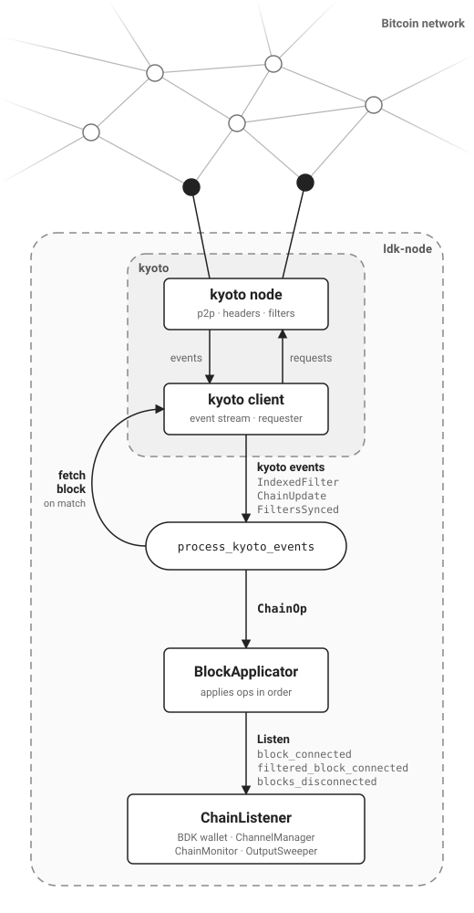

Recently I've finished (jointly with [febyeji](https://github.com/febyeji/)) work on a compact block filter (CBF) chain source for [ldk-node](https://github.com/lightningdevkit/ldk-node) ([PR #828](https://github.com/lightningdevkit/ldk-node/pull/828)).

I'd like to share some details and design behind it.

## ldk-node and LDK

[LDK](https://github.com/lightningdevkit/rust-lightning) is a set of primitives to use Lightning Network, and ldk-node builds on it (together with [BDK](https://github.com/bitcoindevkit/bdk_wallet)) to give a ready-to-go interface for building Lightning applications. Both
LDK and ldk-node are libraries: they have no executables, but serve
as building blocks for user applications. A standalone lightning node application by LDK is [ldk-server](https://github.com/lightningdevkit/ldk-server).

#### Onchain information

Lightning Network nodes need to interact with the blockchain (otherwise they would be completely unrelated to bitcoin).
They need the following from the chain:

- current tip height (to know HTLC expiries)
- channel opening (funding transaction confirmation)
- force close (commitment transaction broadcast)
- revoked commitment broadcast
- splice in/out
- onchain wallet transactions
- broadcast own transaction and know fees

ldk-node abstracts the onchain interaction through the `ChainSource`—something that can provide info about the blockchain.

Chain sources differ in how the onchain information is fed to the ldk-node. They either provide full blocks (`Listen` trait) or only some specific transactions (`Confirm` trait).

There are four chain source implementations:
- bitcoind: we connect to a real bitcoin node and download all blocks,
- [esplora](https://github.com/Blockstream/esplora): we ask an indexing server about specific transactions; it also can
    tell which transactions pay or spend from the wallet's scripts,
- [electrum](https://electrumx.readthedocs.io/en/latest/protocol.html): the same as esplora over a different protocol,

- compact block filter (see below)

Electrum and Esplora leak privacy: service operators know which transactions and scripts we're interested in and thus can link payers and destinations.

Bitcoind (our own node) does not leak privacy, but is a far more resource-hungry service, which is unsuitable, for example, for
mobile phones: running a full node there is impractical.

## Compact block filter node (kyoto)

There is another way we can learn about the chain: via compact block filters. They were introduced as [BIP157](https://github.com/bitcoin/bips/blob/master/bip-0157.mediawiki)/[BIP158](https://github.com/bitcoin/bips/blob/master/bip-0158.mediawiki).

Block filter itself is a piece of data about the block which can tell whether a particular script was involved in this
block (with rare false positives). BIP157 makes them verifiable, i.e. nodes cannot put arbitrary information there (not
entirely[^1]). We can request these filters from the bitcoin network.

[^1]: A BIP158 filter contains the scripts of the outputs a block creates *and* of the outputs it spends. The former are
    in the block itself, the latter live in earlier blocks, so a filter cannot be fully verified against its block alone:
    that would require the input scripts. What a client can do is compare filter headers across several peers and
    download the block when they disagree, so a single rogue peer is detectable, but a filter served by a rogue node
    cannot be proven complete on its own.

Filters do not provide information what transaction did, it means one has to download the whole block in that case.
Though it is still a big improvement, as a typical filter is less than 30KB, while a full block is typically 1–2 MB (up to about 4 MB). And of
course matching transactions occur quite rarely.

There is a Rust implementation of this specification—[Kyoto](https://github.com/2140-dev/kyoto).

#### How it works

Kyoto is a node, which means it manages peers and exchanges messages with them.
That's why it has a few more parameters to build than other chain sources.

Kyoto itself is also a library, meaning it doesn't have an executable, but can be easily embedded into other software.

It is divided into two parts: a node, which handles the node activity; and a client, which sends the information to the
user application as well as allows control of the node.
<!-- , here is the list of them: -->
<!--  -->
<!-- - `peers`: the peers (`ip:port`) to connect to -->
<!-- - `whitelist_only`: connect to those peers only (no DNS seeding, no address gossip) -->
<!-- - `required_peers`: how many peers must stay connected and agree on the compact filter headers -->

Kyoto downloads three types of data:

- headers
- compact block filter headers
- compact block filters themselves

The client feeds this data as chain events to the consumers, these events are:

- `ChainUpdate`: the header chain changed: a new header was connected, a reorganization happened, or a fork was added
- `IndexedFilter`: a compact block filter with its height and block hash; it carries the data needed to test whether
  a particular script belongs to the block
- `FiltersSynced`: kyoto has scanned the whole requested range, i.e. it is caught up with the tip

#### Resources

Kyoto keeps the headers it has downloaded in memory, and streams the filters to the application instead of storing them. So its memory use is proportional to the number of headers, roughly half a kilobyte each (80 bytes on the wire).

ldk-node does not sync from genesis: it resumes from the last block its components have seen (minus a few blocks for reorgs), so only the headers since then are kept. For example, syncing from a year ago (about 52k blocks) takes roughly 20–30 MiB for the headers. For comparison, a sync from the taproot activation checkpoint (about 263k headers) peaked at around 190 MiB, and one from genesis (about 950k headers) at around 740 MiB. The sync time is bound by the network, not by the CPU.

## Compact block filter chain source

The main idea is to maintain some set of watched scripts, listen for events from kyoto and then act accordingly. Let's get into more detail.

<figure class="fig-side">
  
  <figcaption>Data flow of the CBF chain source (click to enlarge).</figcaption>
</figure>

#### Node building and setup

Unlike other chain sources, we're running the blockchain node in a tokio
   task, thus we have full control of it and have to monitor whether it is running, has stopped or needs some attention.

#### Tracked scripts

There are two types of scripts tracked, ones provided by the onchain wallet and others are LDK-specific
   (`ChannelManager`, `OutputSweeper`, `ChainMonitor`—all of them are bound together in `ChainListener`).

   The set of tracked scripts might get updated when we reveal a new address or broadcast a tx. We need to keep it
    up-to-date to avoid missing a tx.
    BDK has its own watched scripts, so keeping a copy could miss some tx due to asynchronicity. Instead each
    time we need a list of watched scripts, we take it from BDK, maintaining a single source of truth. For LDK scripts
    we add a new script each time LDK asks us to watch something through its `Filter` trait (`register_tx` and `register_output`): the funding transaction of a channel, the funding output of a splice, the outputs of a commitment transaction once it confirms, or an output the sweeper is about to claim.

LDK's watched scripts live in `CbfChainSource`. On start they are initialized by `ChainMonitor` and `OutputSweeper`, which register all the scripts they need.

#### Processing kyoto events

After the node is started, we listen to kyoto's events and process them in chain source's `process_kyoto_events`.
It takes the event (a compact block filter), checks whether it contains a script we're interested in (if so, it downloads the block) and sends the
appropriate `ChainOp`eration to another entity—`BlockApplicator`.

#### BlockApplicator

`BlockApplicator` does what its title says: applies block operations, advancing the consumers (the onchain wallet, `ChainMonitor`,
`ChannelManager`, `OutputSweeper`), all of which are bound together in `ChainListener`. It is a distinct entity to simplify design: events arrive asynchronously and fetching
a block takes time, so operations are queued and applied one by one in chain order.

#### Staying in sync

Once all events up to `ChainOp::Synced` are processed, we are up to date and have seen every transaction we care about. `FiltersSynced` alone is not enough: blocks may still be waiting to be applied, which is why `Synced` goes through the same queue.

#### Broadcast and fee sources

Kyoto does not have a mempool, but can broadcast transactions to other peers. The absence of a mempool means we cannot observe unconfirmed transactions, so, for example, we cannot tell whether an
RBF replacement was accepted by the network until a block confirms one of the transactions.

To build transactions (and for LDK's fee decisions) one needs current fee rates. Without a mempool there are three options for that:

- use esplora fee data
- use electrum fee data
- fallback native fee resolution

First two options can use any public service, as they reveal nothing about our wallet by simply asking a provider what the
current fees are (of course, the provider would know our IP).

If there is no electrum/esplora fee provider, one can use fee calculation from recent blocks. For that `CbfChainSource`
downloads the last 14 blocks and calculates the fees paid there by included transactions and estimates
the next fees. This option is only a fallback one, as it forces us to download every new block, which completely undermines
the whole purpose of a CBF node.

## Choosing the wallet birthday

When the node is started for the first time, the wallet is created with its birthday set to the current chain height.
The problem is that we don't know the height without a synced chain source. The solution for that is to run kyoto in
headers-only mode during the build. It syncs the header chain (which takes up to 15 seconds) to obtain the current tip
height.

## Try it

I am running a public node on [Mutinynet](https://mutinynet.com) (a custom signet), which you can try: [ldk-cbf.yyyyy.io](https://ldk-cbf.yyyyy.io/). It runs [ldk-server](https://github.com/randomlogin/ldk-server/tree/cbd-chain-source) with this chain source, and the page is a dashboard showing the state of the node and kyoto's peers.
